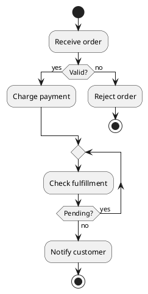

# Activity diagram syntax (modern activity syntax)

Prefer modern activity syntax with `start` and `stop`/`end`; avoid mixing it with legacy `(*)` arrow-based activity syntax.

## Flow control

Actions use `:Action text;`. Conditions: `if (condition) then (yes)` / `elseif (other) then (yes)` / `else (no)` / `endif`. Loops: `while (condition) is (yes)` / actions / `endwhile (no)`; `repeat` / actions / `repeat while (condition) is (yes)`. Parallel paths: `fork` / actions / `fork again` / actions / `end fork`. `split` / `split again` / `end split` is another parallel-flow form. `partition Name { ... }` groups actions by responsibility. Swimlanes may use `|Role|` delimiters.

## Notes and constraints

`note right: ...` adds a short note; `note right ... end note` is multiline. Every branch and loop needs a matching terminator. Use explicit decision labels and a clear stop/end condition. Prefer small activities rather than a single sprawling flow.
