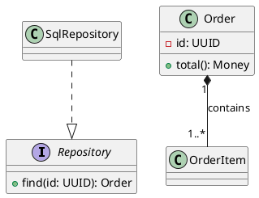

# Class diagram syntax

Define types with `class`, `interface`, `abstract class`, `enum`, `annotation`. Use `package Name { ... }` for grouping.

## Visibility and members

Prefix members with `+` public, `-` private, `#` protected, `~` package. Use `{static}` for static members and `{abstract}` for abstract members. `--` inside a class body separates sections. `hide empty members`, `hide methods`, and `hide attributes` adjust display.

## Relationships

`A -- B` association; `A --> B` directed association; `Child --|> Parent` inheritance; `Impl ..|> Interface` realization; `A ..> B` dependency; `Whole o-- Part` shared aggregation; `Whole *-- Part` composition. Add endpoint multiplicities with quoted strings, e.g. `Customer "1" -- "0..*" Order`. Add role/relationship labels after `:`. Choose composition only for strong lifecycle ownership.

## Other constructs

`note right of Order : explanation` documents modeling assumptions. `class "Long Name" as Short` declares a stable alias. `enum Status { NEW; DONE }` may be written with one member per line. Generic names may require quoting to avoid parser ambiguity. Avoid inventing fields or multiplicities not grounded in requirements.
