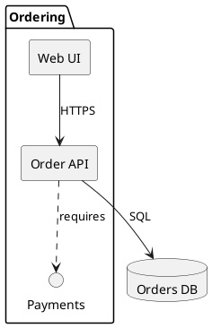

# Component diagram syntax

Model logical modules, interfaces and dependencies, not physical machines.

## Elements

`component "Label" as Alias` or `[Label] as Alias` defines a component. `interface` declares a service contract. `package`, `node`, `folder`, `frame`, and `cloud` may group elements as appropriate. Connect with `--`, `-->`, `..>`, and labeled arrows. `left to right direction` can improve orientation.

## Modeling rules

Distinguish provided interfaces from required dependencies. Name protocols only when known. Prefer explicit arrows over ambiguous unlabeled lines. Use deployment diagrams for physical hosts and class diagrams for internal domain types.
