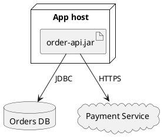

# Deployment diagram syntax

Model where software executes and which nodes communicate.

## Elements and nesting

`node` is a machine/runtime host, `artifact` a deployed software package, `database` a data store, `cloud` an external hosted system. `frame`, `folder`, `package`, `rectangle`, and `component` are available for structural grouping. Nest artifacts within nodes using braces. Use `as` aliases and labeled connectors such as `Host --> DB : TCP`.

## Modeling rules

Differentiate logical components from deployed artifacts and nodes. Avoid assuming network topology, regions, replicas, or encryption details without evidence. If a provider is external, show it outside the system boundary.
