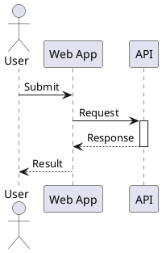

# Sequence diagram syntax

Use for chronological interactions. Participants: `actor User`, `participant Service`, `boundary UI`, `control Logic`, `entity Record`, `database DB`, `collections Items`, `queue Jobs` (availability varies by version). Aliases: `participant "Order API" as API`.

## Messages and lifelines

`->` is a solid message arrow, `-->` a dashed response. `->>` and `-->>` use thin/open arrowheads; `-x` indicates a lost message in supported syntax. Use `++` and `--` suffixes on targets to activate/deactivate where supported. `create` and `destroy` describe lifetimes.

## Combined fragments

`alt condition` / `else other` / `end` for branches; `opt condition` / `end` for optional flow; `loop description` / `end` for repetition; `par` / `else` / `end` for parallel branches; `group label` / `end` for grouping; `break` / `end` for early termination; `critical` / `end` for critical sections.

## Layout

`autonumber` numbers messages. `== Phase ==` creates a divider. `note over A,B: text` annotates participants; `note right of A: text` attaches a note. `ref over A,B: Other interaction` references another sequence. `hide footbox` removes participant footboxes. Declare participant order explicitly when order matters.

## Common mistakes

Do not use class-diagram association cardinalities on messages. Pair each `alt`, `loop`, and `group` with `end`. Use aliases consistently. Keep message labels descriptive and avoid claiming concurrency from simple chronological arrows.
