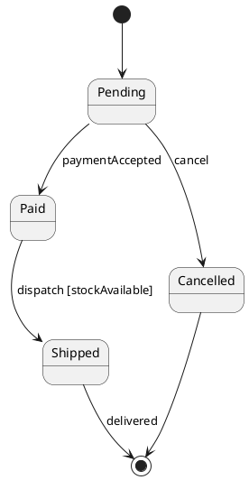

# State diagram syntax

Use state diagrams for event-driven lifecycles. `[*]` represents initial or terminal pseudo-state depending on arrow direction.

## States and transitions

`state "Display name" as ID` gives a stable alias. `A --> B : event [guard] / action` labels a transition. `State : entry / action`, `State : do / activity`, and `State : exit / action` annotate behaviors. Composite states use `state Parent { [*] --> Child ... }`. `state Choice <<choice>>` defines a choice pseudo-state; `state Fork <<fork>>` and `state Join <<join>>` support concurrent regions in supported versions. Use `--` or `||` to separate concurrent regions inside composite states where supported.

## Modeling rules

Every transition should represent a meaningful event or condition. Avoid using activity actions as state names. Keep guard conditions mutually intelligible and model terminal states explicitly.
