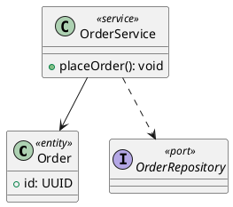
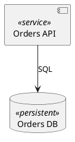
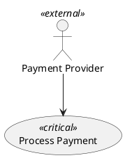
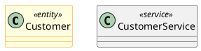

# UML stereotypes in PlantUML — offline reference

A stereotype is a UML extension label that classifies a model element without changing its fundamental UML metaclass. In PlantUML, stereotypes are usually written with double angle brackets: `<<entity>>`, `<<service>>`, `<<boundary>>`. These are **labels**, not automatic enforcement of architectural behavior or type rules.

## Class diagrams

Place a stereotype after a declaration's element name, e.g. `class Customer <<entity>>`. Multiple stereotype-like annotations may be supported depending on the element and version; prefer one clear stereotype unless verified. Stereotypes do not define methods, relationships, multiplicities, or semantics by themselves.

## Components and deployment elements

Stereotypes can annotate supported structural elements. If parsing differs for aliases and stereotype order in the installed PlantUML version, use the local renderer to confirm.

## Use cases and actors

Use stereotypes for domain-specific categorization, not as a substitute for an actor's role or a use case's goal.

## Stereotypes versus keywords

`abstract class`, `interface`, `enum`, `component`, and `actor` are element kinds; `<<entity>>` is a stereotype label. The UML keywords `<<include>>` and `<<extend>>` on use-case relationship labels describe relationship types, not user-defined element stereotypes. In state diagrams, `<<choice>>`, `<<fork>>`, and `<<join>>` are special PlantUML pseudo-state notations rather than arbitrary domain stereotypes.

## Styling stereotypes

PlantUML supports stereotype-aware styling in some diagram types and versions. A common legacy approach is stereotype-specific `skinparam` blocks, for example:

Stereotype-specific `skinparam` behavior and the newer style system vary by PlantUML version. Test with the installed renderer. For a predictable fallback, use explicit colors on elements (e.g. `class Customer #LightYellow`) rather than assuming a stereotype implies styling.

## Practical conventions

- Choose a small, documented vocabulary, such as `<<entity>>`, `<<value-object>>`, `<<service>>`, `<<repository>>`, `<<external>>`.
- Explain the meaning of each project-specific stereotype in a legend or nearby documentation.
- Do not infer behavior or implementation constraints from an arbitrary stereotype.
- Keep stereotype naming consistent across related diagrams.
- Treat stereotypes as optional annotations: the underlying relationships must remain understandable without them.

## Validation

Check the local PlantUML version when styling or applying stereotypes to less-common elements. Run `plantuml -checkonly file.puml` when available; otherwise render locally and inspect the output. No example in this reference should be assumed renderer-validated merely because it is documented.
