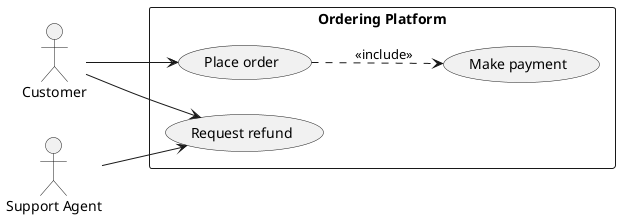

# Use-case diagram syntax

Use actors and user-visible goals, not implementation methods.

## Elements and relationships

`actor Name` or `:Name:` declares an actor. `usecase "Goal" as Alias` or `(Goal)` declares a use case. Use `rectangle "System" { ... }` for a boundary. `Actor --> UseCase` is participation/association. `Base ..> Included : <<include>>` means the base use case always includes required behavior. `Extension ..> Base : <<extend>>` means conditional extension of the base behavior. `Specialized --|> General` models generalization where meaningful.

## Modeling rules

Use action-oriented goal names. Keep actors outside the system boundary. Do not confuse `include` with optional behavior; `extend` is the conditional relationship. Avoid representing API calls or internal algorithms as use cases.
